# Ejemplos progresivos

Esta guía continúa los pipelines mínimos del [README](README.md). Cada nivel es
una configuración completa: conserva lo aprendido y agrega una decisión
arquitectónica nueva.

| Producto | Nivel 1 | Nivel 2 | Nivel 3 |
|---|---|---|---|
| Retrieval | Vector store + reranker | Dos búsquedas + fusión + LLM | Retrieval híbrido completo |
| Tree Classification | Dos estrategias de path | Dense + BM25 + fusiones | Decisión y routing completos |

En todos los diagramas:

- el área crema es el grafo declarado en YAML;
- el área azul contiene los adapters registrados en `ComponentBindings`;
- las flechas sólidas transportan datos;
- las flechas punteadas suben del adapter hacia la etapa que implementa;
- los tramos se leen de arriba abajo y, dentro de cada tramo, de izquierda a derecha;
- las marcas `R1`, `R2`… repiten una salida del tramo anterior, sin volver a ejecutarla.

Las vistas principales son SVG con distribución fija para conservar la
legibilidad en GitHub y en el IDE. Debajo de cada una puedes desplegar el grafo
Mermaid completo. El YAML y los bindings Python describen el mismo pipeline.

Los nombres de bindings terminan en `_adapter`. Un reranker y un selector LLM
de Retrieval son **retrievers restringidos**: declaran `input`, reciben un
ranking existente y solo pueden filtrar o reordenar esos chunks.

# RetrievalPipeline

## Nivel 1: refinar una vector store con un reranker

La vector store genera candidatos con una query embebida. Después, un
cross-encoder vuelve a puntuarlos usando su propio tokenizer.
<!-- 
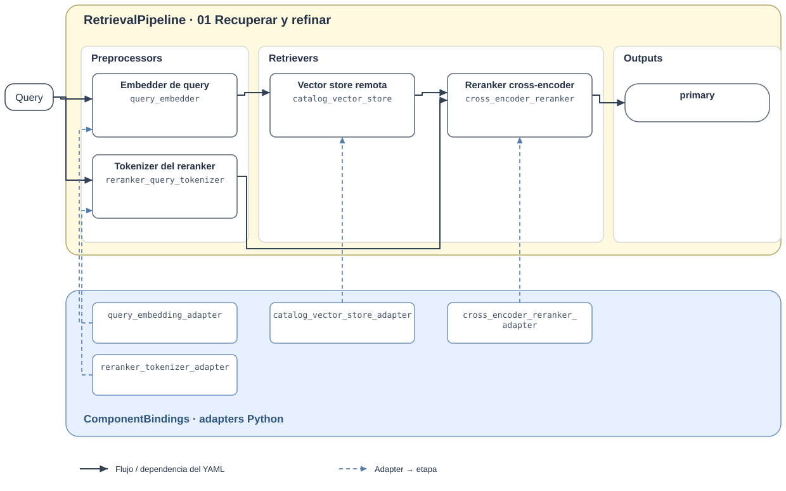

<details>
<summary>Ver grafo Mermaid completo (referencia editable)</summary> -->

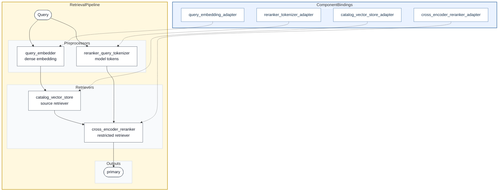

</details>

`retrieval-reranked.yaml`:

```yaml
version: 1
name: reranked_catalog_search
kind: retrieve

preprocessors:
  - name: query_embedder
    binding: query_embedding_adapter
  - name: reranker_query_tokenizer
    binding: reranker_tokenizer_adapter

retrievers:
  - name: catalog_vector_store
    binding: catalog_vector_store_adapter
    preprocessor: query_embedder
    top_k: 100
  - name: cross_encoder_reranker
    binding: cross_encoder_reranker_adapter
    preprocessor: reranker_query_tokenizer
    input: catalog_vector_store
    top_k: 10

outputs:
  primary: cross_encoder_reranker
```

Bindings — reutiliza los adapters de embedding y vector store del README:

```python
from chunkbuster import ComponentBindings, RankedItem, Ranking


class RerankerTokenizerAdapter:
    def __init__(self, tokenizer):
        self.tokenizer = tokenizer

    async def prepare_query(self, text):
        return self.tokenizer.encode(text)


class CrossEncoderRerankerAdapter:
    def __init__(self, model):
        self.model = model

    async def retrieve_candidates(self, query_tokens, candidates, *, top_k):
        scores = await self.model.score(
            query_tokens,
            [item.item.text for item in candidates],
        )
        rescored = (
            RankedItem(item.id, item.item, score)
            for item, score in zip(candidates, scores, strict=True)
        )
        return Ranking(tuple(sorted(rescored, key=lambda item: -item.score))[:top_k])


bindings = ComponentBindings(
    preprocessors={
        "query_embedding_adapter": QueryEmbeddingAdapter(embedding_model),
        "reranker_tokenizer_adapter": RerankerTokenizerAdapter(reranker_tokenizer),
    },
    retrievers={
        "catalog_vector_store_adapter": CatalogVectorStoreAdapter(vector_store),
        "cross_encoder_reranker_adapter": CrossEncoderRerankerAdapter(reranker_model),
    },
)
```

## Nivel 2: fusionar búsquedas y terminar con un LLM

Una vector store remota y una búsqueda vectorial local producen rankings
independientes. `vector_rank_fusion` los combina por posición, el reranker los
refina y el LLM elige el chunk final dentro de esa lista.
<!-- 
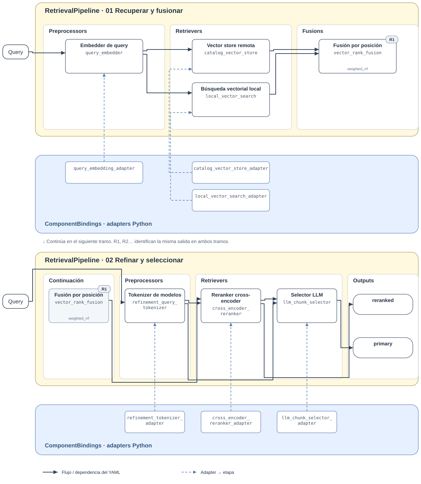

<details>
<summary>Ver grafo Mermaid completo (referencia editable)</summary> -->

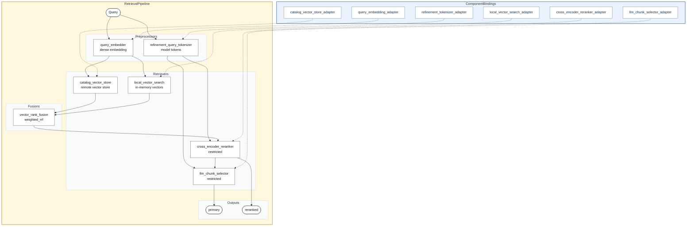

</details>

`retrieval-vector-ensemble.yaml`:

```yaml
version: 1
name: vector_ensemble_with_llm
kind: retrieve

preprocessors:
  - name: query_embedder
    binding: query_embedding_adapter
  - name: refinement_query_tokenizer
    binding: refinement_tokenizer_adapter

retrievers:
  - name: catalog_vector_store
    binding: catalog_vector_store_adapter
    preprocessor: query_embedder
    top_k: 100
  - name: local_vector_search
    binding: local_vector_search_adapter
    preprocessor: query_embedder
    top_k: 100
  - name: cross_encoder_reranker
    binding: cross_encoder_reranker_adapter
    preprocessor: refinement_query_tokenizer
    input: vector_rank_fusion
    top_k: 20
  - name: llm_chunk_selector
    binding: llm_chunk_selector_adapter
    preprocessor: refinement_query_tokenizer
    input: cross_encoder_reranker
    top_k: 1

fusions:
  - name: vector_rank_fusion
    type: weighted_rrf
    inputs: [catalog_vector_store, local_vector_search]
    weights: [0.6, 0.4]
    k: 60
    top_k: 50

outputs:
  primary: llm_chunk_selector
  reranked: cross_encoder_reranker
```

Bindings — el LLM devuelve IDs de los candidatos; el adapter conserva los
objetos `Chunk` canónicos:

```python
from chunkbuster import ComponentBindings, Ranking


class LocalVectorSearchAdapter:
    def __init__(self, index):
        self.index = index

    async def retrieve(self, vector, *, top_k):
        return self.index.search(vector, top_k=top_k)


class LLMChunkSelectorAdapter:
    def __init__(self, llm):
        self.llm = llm

    async def retrieve_candidates(self, query_tokens, candidates, *, top_k):
        chosen_ids = await self.llm.choose_chunks(
            query_tokens=query_tokens,
            candidates=[item.item for item in candidates],
            limit=top_k,
        )
        by_id = {item.id: item for item in candidates}
        return Ranking(tuple(by_id[item_id] for item_id in chosen_ids))


bindings = ComponentBindings(
    preprocessors={
        "query_embedding_adapter": QueryEmbeddingAdapter(embedding_model),
        "refinement_tokenizer_adapter": RerankerTokenizerAdapter(tokenizer),
    },
    retrievers={
        "catalog_vector_store_adapter": CatalogVectorStoreAdapter(vector_store),
        "local_vector_search_adapter": LocalVectorSearchAdapter(local_index),
        "cross_encoder_reranker_adapter": CrossEncoderRerankerAdapter(reranker_model),
        "llm_chunk_selector_adapter": LLMChunkSelectorAdapter(llm),
    },
)
```

El pipeline rechazará cualquier ID que el LLM invente o que ya no pertenezca
al ranking recibido.

## Nivel 3: retrieval híbrido completo

Se agrega BM25 como tercera fuente. Una fusión por rank tolera escalas
incomparables; otra fusión por score normaliza cada ranking. El consenso,
reranker y selector LLM aportan tres formas sucesivas de ganar precisión.
<!-- 
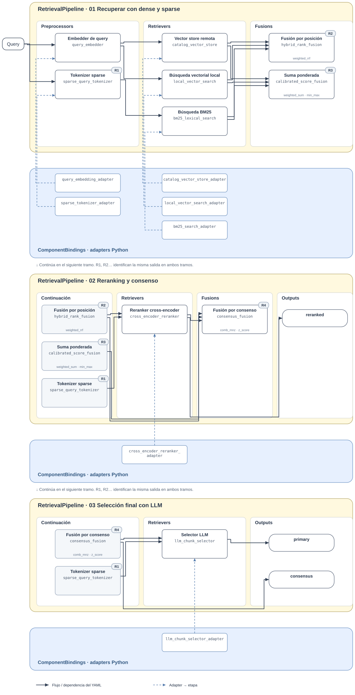

<details>
<summary>Ver grafo Mermaid completo (referencia editable)</summary> -->

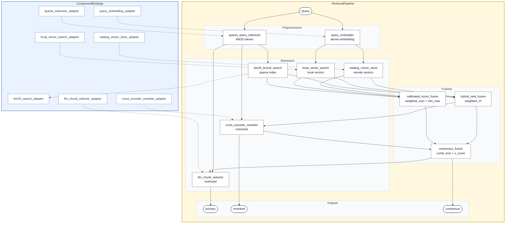

</details>

`retrieval-complete.yaml`:

```yaml
version: 1
name: precise_hybrid_search
kind: retrieve

preprocessors:
  - name: query_embedder
    binding: query_embedding_adapter
  - name: sparse_query_tokenizer
    binding: sparse_tokenizer_adapter

retrievers:
  - name: catalog_vector_store
    binding: catalog_vector_store_adapter
    preprocessor: query_embedder
    top_k: 100
  - name: local_vector_search
    binding: local_vector_search_adapter
    preprocessor: query_embedder
    top_k: 100
  - name: bm25_lexical_search
    binding: bm25_search_adapter
    preprocessor: sparse_query_tokenizer
    top_k: 100
  - name: cross_encoder_reranker
    binding: cross_encoder_reranker_adapter
    preprocessor: sparse_query_tokenizer
    input: hybrid_rank_fusion
    top_k: 30
  - name: llm_chunk_selector
    binding: llm_chunk_selector_adapter
    preprocessor: sparse_query_tokenizer
    input: consensus_fusion
    top_k: 1

fusions:
  - name: hybrid_rank_fusion
    type: weighted_rrf
    inputs: [catalog_vector_store, local_vector_search, bm25_lexical_search]
    weights: [0.5, 0.2, 0.3]
    k: 60
    top_k: 50
  - name: calibrated_score_fusion
    type: weighted_sum
    inputs: [catalog_vector_store, local_vector_search, bm25_lexical_search]
    weights: [0.5, 0.2, 0.3]
    normalization: min_max
    top_k: 50
  - name: consensus_fusion
    type: comb_mnz
    inputs: [hybrid_rank_fusion, calibrated_score_fusion, cross_encoder_reranker]
    normalization: z_score
    top_k: 10

outputs:
  primary: llm_chunk_selector
  reranked: cross_encoder_reranker
  consensus: consensus_fusion
```

Bindings:

```python
from chunkbuster import ComponentBindings, TextTokenizer


class BM25SearchAdapter:
    def __init__(self, index):
        self.index = index

    async def retrieve(self, tokens, *, top_k):
        return self.index.search(tokens, top_k=top_k)


bindings = ComponentBindings(
    preprocessors={
        "query_embedding_adapter": QueryEmbeddingAdapter(embedding_model),
        "sparse_tokenizer_adapter": TextTokenizer(
            mode="word",
            case_sensitive=False,
            strip_accents=True,
            min_length=2,
            stop_words={"de", "la", "el"},
        ),
    },
    retrievers={
        "catalog_vector_store_adapter": CatalogVectorStoreAdapter(vector_store),
        "local_vector_search_adapter": LocalVectorSearchAdapter(local_index),
        "bm25_search_adapter": BM25SearchAdapter(bm25_index),
        "cross_encoder_reranker_adapter": CrossEncoderRerankerAdapter(reranker_model),
        "llm_chunk_selector_adapter": LLMChunkSelectorAdapter(llm),
    },
)
```

`BM25SearchAdapter` es un retriever fuente: implementa
`retrieve(tokens, *, top_k)`. Las fusiones son internas y no necesitan binding.

# TreeClassificationPipeline

Los siguientes niveles reutilizan la taxonomía y `TaxonomyEmbeddingAdapter` del
README. A diferencia de Retrieval, dense y BM25 producen `NodeScores`; después
los path scorers construyen rankings de paths y los deciders publican una
selección.

## Nivel 1: comparar dos estrategias de path

Un único scorer semántico alimenta dos lecturas del árbol: promedio de todos
los nodos y una suma que da más peso a la hoja.

<!-- 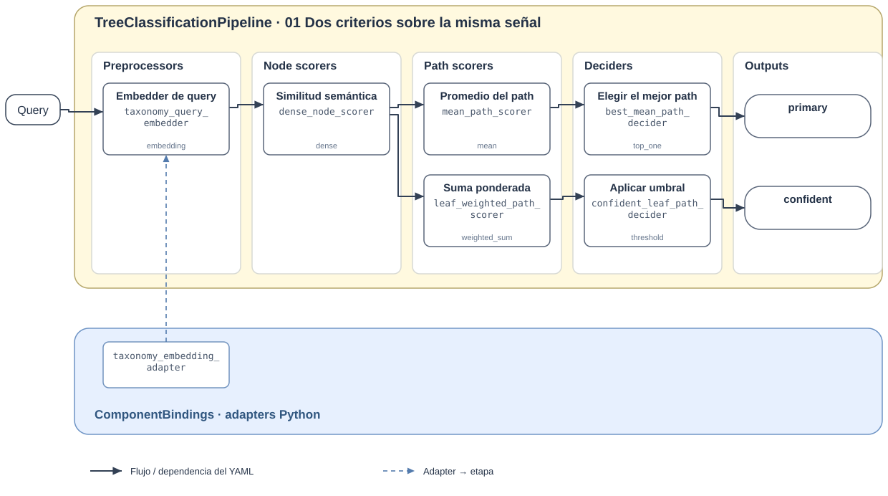

<details>
<summary>Ver grafo Mermaid completo (referencia editable)</summary> -->

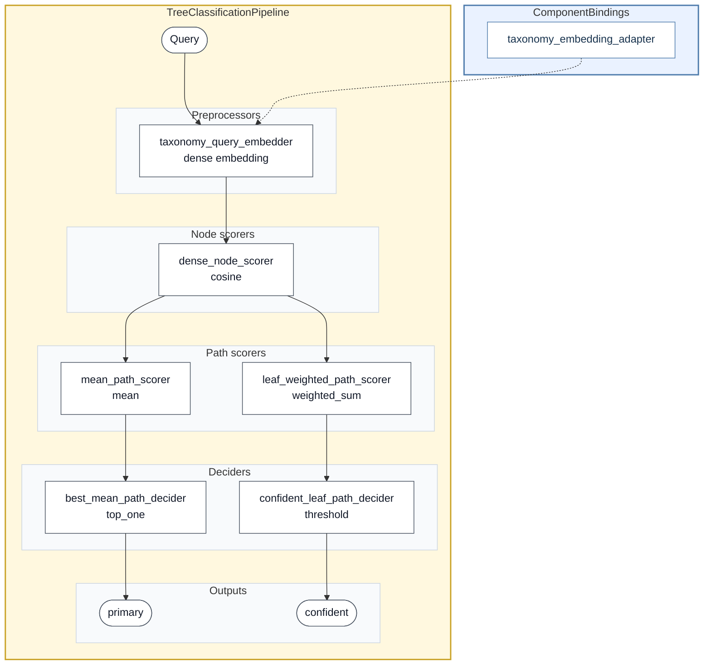

</details>

`tree-path-strategies.yaml`:

```yaml
version: 1
name: semantic_path_strategies
kind: tree_classification

preprocessors:
  - name: taxonomy_query_embedder
    type: embedding
    binding: taxonomy_embedding_adapter
    dimensions: 3

node_scorers:
  - name: dense_node_scorer
    type: dense
    preprocessor: taxonomy_query_embedder
    similarity: cosine

path_scorers:
  - name: mean_path_scorer
    type: mean
    input: dense_node_scorer
    top_k: 10
  - name: leaf_weighted_path_scorer
    type: weighted_sum
    input: dense_node_scorer
    terms:
      mean: 0.4
      leaf: 0.6
    top_k: 10

deciders:
  - name: best_mean_path_decider
    type: top_one
    input: mean_path_scorer
  - name: confident_leaf_path_decider
    type: threshold
    input: leaf_weighted_path_scorer
    min_score: 0.55
    count: 3

outputs:
  primary: best_mean_path_decider
  confident: confident_leaf_path_decider
```

Bindings:

```python
from chunkbuster import ComponentBindings

bindings = ComponentBindings(
    preprocessors={
        "taxonomy_embedding_adapter": TaxonomyEmbeddingAdapter(embedding_model),
    },
)
```

## Nivel 2: dense + BM25 antes y después del path scoring

El embedder y el tokenizer generan dos señales por nodo. Una node fusion crea
un score híbrido antes de construir paths; una path fusion reúne tres rankings
ya construidos. Son decisiones distintas y pueden convivir.
<!-- 
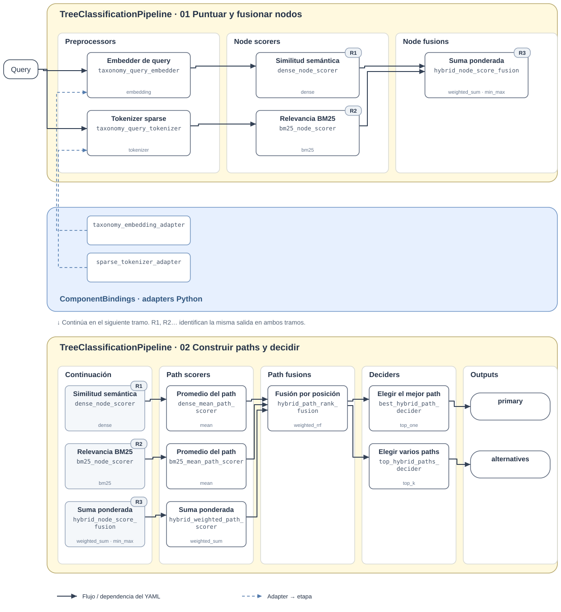

<details>
<summary>Ver grafo Mermaid completo (referencia editable)</summary> -->

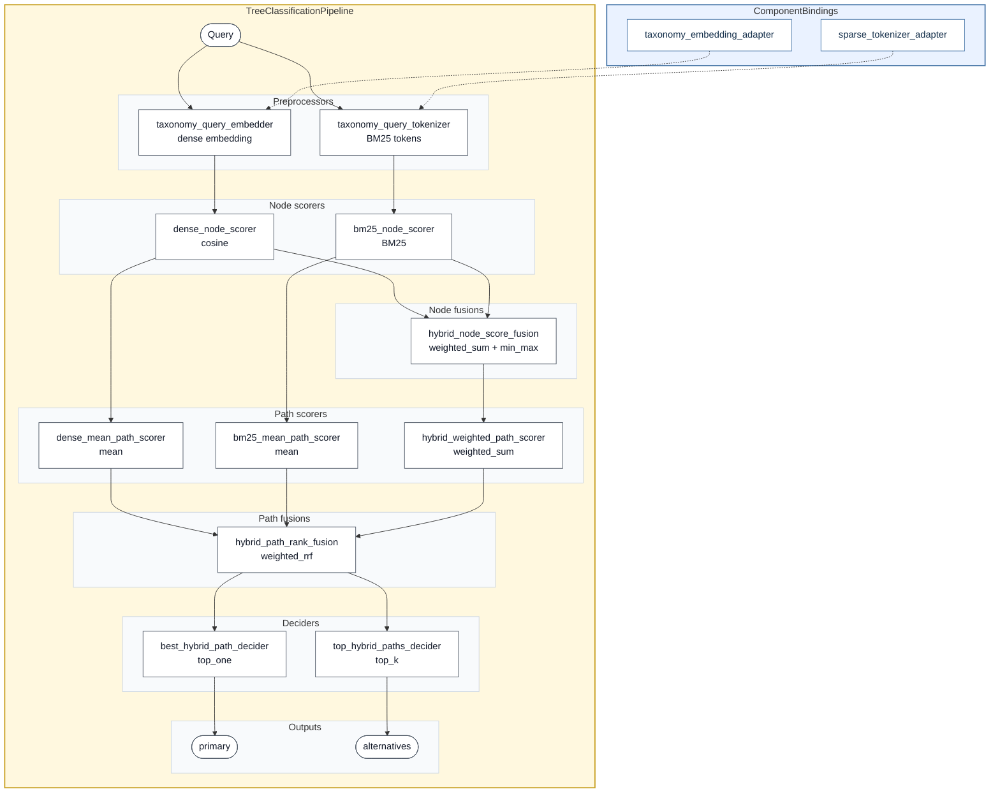

</details>

`tree-hybrid.yaml`:

```yaml
version: 1
name: hybrid_support_classifier
kind: tree_classification

preprocessors:
  - name: taxonomy_query_embedder
    type: embedding
    binding: taxonomy_embedding_adapter
    dimensions: 3
  - name: taxonomy_query_tokenizer
    type: tokenizer
    binding: sparse_tokenizer_adapter

node_scorers:
  - name: dense_node_scorer
    type: dense
    preprocessor: taxonomy_query_embedder
    similarity: cosine
  - name: bm25_node_scorer
    type: bm25
    preprocessor: taxonomy_query_tokenizer
    k1: 1.2
    b: 0.75

node_fusions:
  - name: hybrid_node_score_fusion
    type: weighted_sum
    inputs: [dense_node_scorer, bm25_node_scorer]
    weights: [0.65, 0.35]
    normalization: min_max

path_scorers:
  - name: dense_mean_path_scorer
    type: mean
    input: dense_node_scorer
    top_k: 20
  - name: bm25_mean_path_scorer
    type: mean
    input: bm25_node_scorer
    top_k: 20
  - name: hybrid_weighted_path_scorer
    type: weighted_sum
    input: hybrid_node_score_fusion
    terms:
      mean: 0.4
      leaf: 0.6
    top_k: 20

path_fusions:
  - name: hybrid_path_rank_fusion
    type: weighted_rrf
    inputs:
      - dense_mean_path_scorer
      - bm25_mean_path_scorer
      - hybrid_weighted_path_scorer
    weights: [0.3, 0.2, 0.5]
    k: 60
    top_k: 10

deciders:
  - name: best_hybrid_path_decider
    type: top_one
    input: hybrid_path_rank_fusion
  - name: top_hybrid_paths_decider
    type: top_k
    input: hybrid_path_rank_fusion
    count: 3

outputs:
  primary: best_hybrid_path_decider
  alternatives: top_hybrid_paths_decider
```

Bindings — el tokenizer sirve tanto para la query como para completar los
tokens ausentes de la taxonomía durante `build()`:

```python
from chunkbuster import ComponentBindings, TextTokenizer

bindings = ComponentBindings(
    preprocessors={
        "taxonomy_embedding_adapter": TaxonomyEmbeddingAdapter(embedding_model),
        "sparse_tokenizer_adapter": TextTokenizer(
            mode="word",
            case_sensitive=False,
            strip_accents=True,
            min_length=2,
        ),
    },
)
```

## Nivel 3: ensamble y decisión adaptativa completos

El grafo conserva tres fusiones de nodos, tres formas de puntuar paths y tres
fusiones de rankings. Los deciders ofrecen decisión rápida, shortlist,
umbral o revisión LLM. El router elige cuál ejecutar para el output principal.

En el último tramo, las flechas hacia el router indican los deciders permitidos
por el YAML. Al ejecutar, el router inspecciona sus rankings y elige qué decider
ejecutar; no recibe ni fusiona decisiones ya ejecutadas.

<!-- 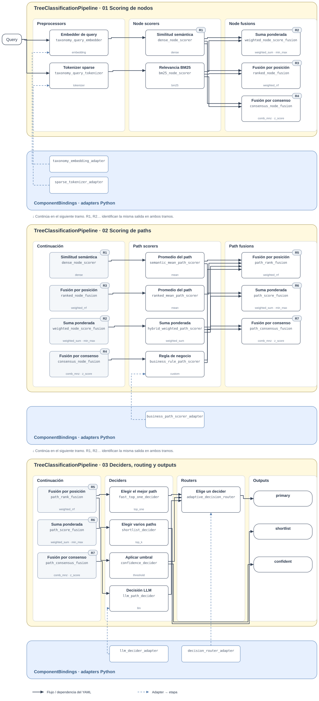

<details>
<summary>Ver grafo Mermaid completo (referencia editable)</summary> -->

```mermaid
flowchart TB
    subgraph pipeline["TreeClassificationPipeline"]
        direction TB
        query([Query])
        subgraph preprocessors[Preprocessors]
            taxonomy_query_embedder["taxonomy_query_embedder<br/>dense embedding"]
            taxonomy_query_tokenizer["taxonomy_query_tokenizer<br/>BM25 tokens"]
        end
        subgraph node_scorers[Node scorers]
            dense_node_scorer["dense_node_scorer<br/>cosine"]
            bm25_node_scorer["bm25_node_scorer<br/>BM25"]
        end
        subgraph node_fusions[Node fusions]
            weighted_node_score_fusion["weighted_node_score_fusion<br/>weighted_sum"]
            ranked_node_fusion["ranked_node_fusion<br/>weighted_rrf"]
            consensus_node_fusion["consensus_node_fusion<br/>comb_mnz"]
        end
        subgraph path_scorers[Path scorers]
            semantic_mean_path_scorer["semantic_mean_path_scorer<br/>mean"]
            ranked_mean_path_scorer["ranked_mean_path_scorer<br/>mean"]
            hybrid_weighted_path_scorer["hybrid_weighted_path_scorer<br/>weighted_sum"]
            business_rule_path_scorer["business_rule_path_scorer<br/>custom"]
        end
        subgraph path_fusions[Path fusions]
            path_rank_fusion["path_rank_fusion<br/>weighted_rrf"]
            path_score_fusion["path_score_fusion<br/>weighted_sum"]
            path_consensus_fusion["path_consensus_fusion<br/>comb_mnz"]
        end
        subgraph deciders[Deciders]
            fast_top_one_decider["fast_top_one_decider<br/>top_one"]
            shortlist_decider["shortlist_decider<br/>top_k"]
            confidence_decider["confidence_decider<br/>threshold"]
            llm_path_decider["llm_path_decider<br/>LLM"]
        end
        subgraph routers[Routers]
            adaptive_decision_router[adaptive_decision_router]
        end
        subgraph outputs[Outputs]
            primary([primary])
            shortlist([shortlist])
            confident([confident])
        end
        query --> taxonomy_query_embedder --> dense_node_scorer
        query --> taxonomy_query_tokenizer --> bm25_node_scorer
        dense_node_scorer --> weighted_node_score_fusion
        bm25_node_scorer --> weighted_node_score_fusion
        dense_node_scorer --> ranked_node_fusion
        bm25_node_scorer --> ranked_node_fusion
        dense_node_scorer --> consensus_node_fusion
        bm25_node_scorer --> consensus_node_fusion
        dense_node_scorer --> semantic_mean_path_scorer
        ranked_node_fusion --> ranked_mean_path_scorer
        weighted_node_score_fusion --> hybrid_weighted_path_scorer
        consensus_node_fusion --> business_rule_path_scorer
        semantic_mean_path_scorer --> path_rank_fusion
        ranked_mean_path_scorer --> path_rank_fusion
        hybrid_weighted_path_scorer --> path_rank_fusion
        business_rule_path_scorer --> path_rank_fusion
        semantic_mean_path_scorer --> path_score_fusion
        hybrid_weighted_path_scorer --> path_score_fusion
        business_rule_path_scorer --> path_consensus_fusion
        hybrid_weighted_path_scorer --> path_consensus_fusion
        path_rank_fusion --> fast_top_one_decider
        path_rank_fusion --> shortlist_decider
        path_score_fusion --> confidence_decider
        path_consensus_fusion --> llm_path_decider
        fast_top_one_decider --> adaptive_decision_router
        confidence_decider --> adaptive_decision_router
        llm_path_decider --> adaptive_decision_router
        adaptive_decision_router --> primary
        shortlist_decider --> shortlist
        confidence_decider --> confident
    end

    subgraph bindings["ComponentBindings"]
        direction LR
        taxonomy_embedding_adapter[taxonomy_embedding_adapter]
        sparse_tokenizer_adapter[sparse_tokenizer_adapter]
        business_path_scorer_adapter[business_path_scorer_adapter]
        llm_decider_adapter[llm_decider_adapter]
        decision_router_adapter[decision_router_adapter]
    end
    taxonomy_embedding_adapter -.-> taxonomy_query_embedder
    sparse_tokenizer_adapter -.-> taxonomy_query_tokenizer
    business_path_scorer_adapter -.-> business_rule_path_scorer
    llm_decider_adapter -.-> llm_path_decider
    decision_router_adapter -.-> adaptive_decision_router

    classDef node fill:#ffffff,stroke:#4b5563,color:#111827
    classDef adapter fill:#ffffff,stroke:#4f7cac,color:#17324d
    class query,taxonomy_query_embedder,taxonomy_query_tokenizer,dense_node_scorer,bm25_node_scorer,weighted_node_score_fusion,ranked_node_fusion,consensus_node_fusion,semantic_mean_path_scorer,ranked_mean_path_scorer,hybrid_weighted_path_scorer,business_rule_path_scorer,path_rank_fusion,path_score_fusion,path_consensus_fusion,fast_top_one_decider,shortlist_decider,confidence_decider,llm_path_decider,adaptive_decision_router,primary,shortlist,confident node
    class taxonomy_embedding_adapter,sparse_tokenizer_adapter,business_path_scorer_adapter,llm_decider_adapter,decision_router_adapter adapter
    style pipeline fill:#fff8df,stroke:#c9a227,stroke-width:2px
    style bindings fill:#eaf2ff,stroke:#4f7cac,stroke-width:2px
    style preprocessors fill:#f8fafc,stroke:#cbd5e1
    style node_scorers fill:#f8fafc,stroke:#cbd5e1
    style node_fusions fill:#f8fafc,stroke:#cbd5e1
    style path_scorers fill:#f8fafc,stroke:#cbd5e1
    style path_fusions fill:#f8fafc,stroke:#cbd5e1
    style deciders fill:#f8fafc,stroke:#cbd5e1
    style routers fill:#f8fafc,stroke:#cbd5e1
    style outputs fill:#f8fafc,stroke:#cbd5e1
```

</details>

`tree-complete.yaml`:

```yaml
version: 1
name: adaptive_hybrid_classifier
kind: tree_classification

preprocessors:
  - name: taxonomy_query_embedder
    type: embedding
    binding: taxonomy_embedding_adapter
    dimensions: 3
  - name: taxonomy_query_tokenizer
    type: tokenizer
    binding: sparse_tokenizer_adapter

node_scorers:
  - name: dense_node_scorer
    type: dense
    preprocessor: taxonomy_query_embedder
    similarity: cosine
  - name: bm25_node_scorer
    type: bm25
    preprocessor: taxonomy_query_tokenizer
    k1: 1.2
    b: 0.75

node_fusions:
  - name: weighted_node_score_fusion
    type: weighted_sum
    inputs: [dense_node_scorer, bm25_node_scorer]
    weights: [0.65, 0.35]
    normalization: min_max
  - name: ranked_node_fusion
    type: weighted_rrf
    inputs: [dense_node_scorer, bm25_node_scorer]
    weights: [0.55, 0.45]
    k: 60
  - name: consensus_node_fusion
    type: comb_mnz
    inputs: [dense_node_scorer, bm25_node_scorer]
    normalization: z_score

path_scorers:
  - name: semantic_mean_path_scorer
    type: mean
    input: dense_node_scorer
    top_k: 30
  - name: ranked_mean_path_scorer
    type: mean
    input: ranked_node_fusion
    top_k: 30
  - name: hybrid_weighted_path_scorer
    type: weighted_sum
    input: weighted_node_score_fusion
    terms:
      root: 0.1
      mean: 0.3
      leaf: 0.6
    top_k: 30
  - name: business_rule_path_scorer
    type: custom
    input: consensus_node_fusion
    binding: business_path_scorer_adapter
    top_k: 30

path_fusions:
  - name: path_rank_fusion
    type: weighted_rrf
    inputs:
      - semantic_mean_path_scorer
      - ranked_mean_path_scorer
      - hybrid_weighted_path_scorer
      - business_rule_path_scorer
    weights: [0.2, 0.2, 0.4, 0.2]
    k: 60
    top_k: 15
  - name: path_score_fusion
    type: weighted_sum
    inputs: [semantic_mean_path_scorer, hybrid_weighted_path_scorer]
    weights: [0.4, 0.6]
    normalization: min_max
    top_k: 15
  - name: path_consensus_fusion
    type: comb_mnz
    inputs: [hybrid_weighted_path_scorer, business_rule_path_scorer]
    normalization: z_score
    top_k: 15

deciders:
  - name: fast_top_one_decider
    type: top_one
    input: path_rank_fusion
  - name: shortlist_decider
    type: top_k
    input: path_rank_fusion
    count: 3
  - name: confidence_decider
    type: threshold
    input: path_score_fusion
    min_score: 0.65
    count: 3
  - name: llm_path_decider
    type: llm
    input: path_consensus_fusion
    binding: llm_decider_adapter
    count: 1

routers:
  - name: adaptive_decision_router
    deciders:
      - fast_top_one_decider
      - confidence_decider
      - llm_path_decider
    binding: decision_router_adapter
    parameters:
      ambiguity_margin: 0.08

outputs:
  primary: adaptive_decision_router
  shortlist: shortlist_decider
  confident: confidence_decider
```

Bindings:

```python
from chunkbuster import ComponentBindings, DecisionRoute, DecisionSelection, TextTokenizer


class BusinessPathScorerAdapter:
    async def score_path(self, path, node_scores):
        base = sum(node_scores[node_id] for node_id in path.node_ids)
        priority = float(path.nodes[-1].metadata.get("priority", 0.0))
        return base + priority


class LLMPathDeciderAdapter:
    def __init__(self, llm):
        self.llm = llm

    async def decide(self, query, candidates, *, count):
        path_ids = await self.llm.choose_paths(query, candidates, limit=count)
        return DecisionSelection(
            path_ids=tuple(path_ids),
            reason="Selected after semantic review",
        )


class AdaptiveDecisionRouterAdapter:
    async def route(self, query, candidates, *, parameters):
        confidence = candidates["confidence_decider"]
        if confidence:
            return DecisionRoute("confidence_decider")
        fast = candidates["fast_top_one_decider"]
        margin = parameters["ambiguity_margin"]
        if len(fast) == 1 and fast[0].score >= 1.0 - margin:
            return DecisionRoute("fast_top_one_decider")
        return DecisionRoute("llm_path_decider")


bindings = ComponentBindings(
    preprocessors={
        "taxonomy_embedding_adapter": TaxonomyEmbeddingAdapter(embedding_model),
        "sparse_tokenizer_adapter": TextTokenizer(
            mode="word",
            case_sensitive=False,
            strip_accents=True,
        ),
    },
    path_scorers={
        "business_path_scorer_adapter": BusinessPathScorerAdapter(),
    },
    deciders={
        "llm_decider_adapter": LLMPathDeciderAdapter(llm),
    },
    routers={
        "decision_router_adapter": AdaptiveDecisionRouterAdapter(),
    },
)
```

El router recibe un mapping de solo lectura
`decider_name -> Ranking[TaxonomyPath]`. Elige un decider permitido; no ejecuta
ni modifica rankings. Cada rama declarada termina en un output, router o
fusión, por lo que el build no acepta ramas colgadas.
