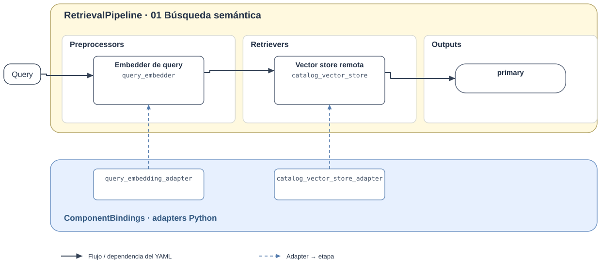
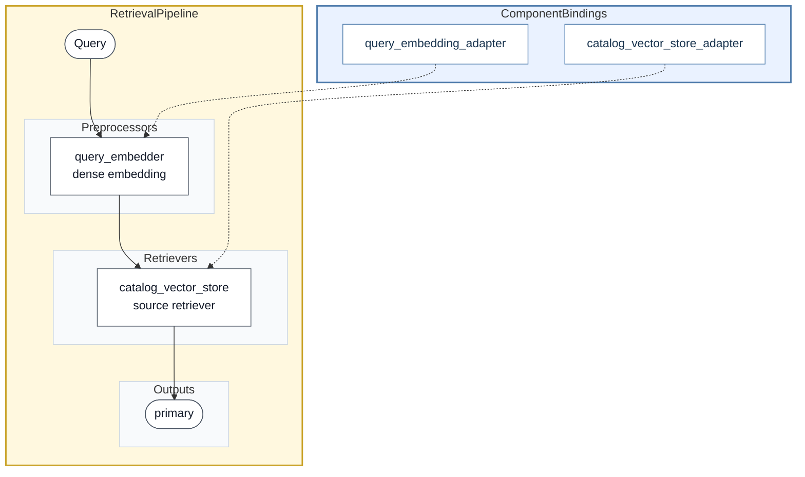
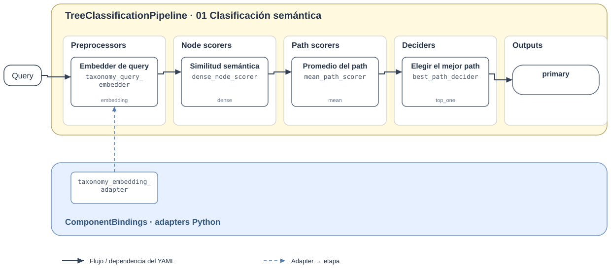
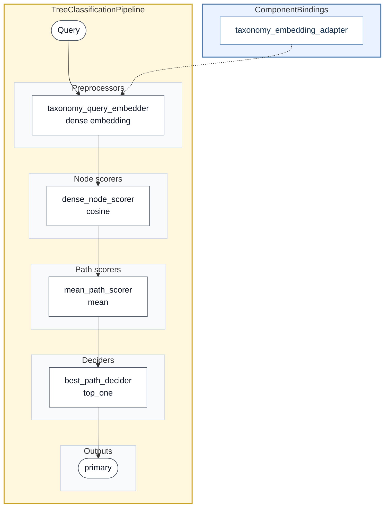

# Chunkbuster

**Diseña retrieval y clasificación jerárquica como grafos declarativos.**

Tu estrategia de ranking debería cambiar en YAML, no quedar repartida por todo
el código. Chunkbuster separa la topología del pipeline de las tecnologías que
la ejecutan: conecta tus modelos, índices y reglas como adapters Python;
combínalos y publica varios resultados sin acoplarte a un proveedor.

> API experimental. Requiere Python 3.12 o superior.

| Producto | Para qué sirve | Qué combina |
|---|---|---|
| `RetrievalPipeline` | Recuperar, refinar y ordenar chunks | Vector stores, búsqueda local, rerankers, selectores LLM, fusiones y routers |
| `TreeClassificationPipeline` | Elegir paths de una taxonomía | Dense/BM25, scoring de paths, fusiones, reglas y LLMs |

## Por qué Chunkbuster

- **Híbrido de verdad:** dense y sparse pueden convivir antes y después de
  construir rankings.
- **Configurable sin magia:** YAML describe el grafo; Python implementa solo
  las integraciones externas.
- **Ramas concurrentes:** cada nodo arranca cuando sus dependencias están listas,
  sin esperar a otras ramas ni a todo su nivel.
- **Seguro al construir:** referencias rotas, ciclos, nombres duplicados y
  ramas sin salida fallan antes de procesar tráfico.
- **Proveedor agnóstico:** trae tu vector store, buscador, modelo de embeddings o
  LLM. Chunkbuster no gestiona SDKs, credenciales ni secretos.
- **Contratos pequeños:** bindings asíncronos; resultados tipados e
  inmutables.

## Instalación

Con `pip`:

```bash
python -m pip install chunkbuster
```

Con `uv`:

```bash
uv add chunkbuster
```

Para trabajar en el repositorio:

```bash
git clone https://github.com/cristiangofiar/Chunkbuster.git
cd Chunkbuster
uv sync --dev
uv run pytest
uv run ruff check .
```

## Configuración y bindings

La configuración responde **qué se conecta**. Los bindings responden **cómo se
ejecuta**.

```python
pipeline = await SomePipeline.build(
    config="pipeline.yaml",
    bindings=ComponentBindings(...),
)
```

El valor de `binding` busca una clave dentro de `ComponentBindings`. En esta
documentación esas claves terminan en `_adapter`, para distinguir claramente el
nodo configurado del objeto Python que lo implementa.

Los diagramas se leen de izquierda a derecha: pipeline en crema y adapters
en azul, debajo de sus etapas. Las flechas punteadas indican inyección de
bindings. La vista SVG mantiene esa distribución; el Mermaid completo queda
disponible en un desplegable bajo cada imagen.

¿Quieres pasar de estos ejemplos mínimos a búsqueda híbrida, reranking,
selección con LLM, node/path fusion y routing? Consulta los
[ejemplos avanzados](https://github.com/cristiangofiar/Chunkbuster/blob/master/EXAMPLES.md).

## Retrieval mínimo

La query se transforma en un embedding y una vector store introduce los
primeros chunks al pipeline.
<!-- 


<details>
<summary>Ver grafo Mermaid completo (referencia editable)</summary> -->



</details>

`retrieval-simple.yaml`:

```yaml
version: 1
name: semantic_catalog_search
kind: retrieve

preprocessors:
  - name: query_embedder
    binding: query_embedding_adapter

retrievers:
  - name: catalog_vector_store
    binding: catalog_vector_store_adapter
    preprocessor: query_embedder
    top_k: 10

outputs:
  primary: catalog_vector_store
```

Bindings y ejecución:

```python
from chunkbuster import ComponentBindings, RankedItem, Ranking
from chunkbuster.retrieval import Chunk, RetrievalPipeline


class QueryEmbeddingAdapter:
    def __init__(self, model):
        self.model = model

    async def prepare_query(self, query):
        return await self.model.embed(query.text)


class CatalogVectorStoreAdapter:
    def __init__(self, store):
        self.store = store

    async def retrieve(self, query, vector, *, top_k):
        hits = await self.store.search(vector, limit=top_k)
        return Ranking(
            tuple(
                RankedItem(
                    hit.id,
                    Chunk(hit.id, hit.text, hit.metadata),
                    hit.score,
                )
                for hit in hits
            )
        )


bindings = ComponentBindings(
    preprocessors={
        "query_embedding_adapter": QueryEmbeddingAdapter(embedding_model),
    },
    retrievers={
        "catalog_vector_store_adapter": CatalogVectorStoreAdapter(vector_store),
    },
)

pipeline = await RetrievalPipeline.build(
    config="retrieval-simple.yaml",
    bindings=bindings,
)
result = await pipeline.retrieve("Auriculares inalámbricos")
print(result.outputs["primary"].ranking.ids)
```

Un reranker o un selector LLM declara `inputs` con un nombre o una lista de
nombres. El binding recibe los rankings por nombre. Un router inspecciona rankings y
publica el ranking de la rama que elige. La guía avanzada incluye un
[ejemplo con un router de retrieval](EXAMPLES.md#nivel-4-elegir-una-rama-con-un-router-de-retrieval).

## Clasificación semántica mínima

`build()` genera una vez los embeddings ausentes de la taxonomía. Después, cada
query se compara contra sus nodos y el mejor path se convierte en la decisión.
<!-- 


<details>
<summary>Ver grafo Mermaid completo (referencia editable)</summary> -->



</details>

`tree-simple.yaml`:

```yaml
version: 1
name: semantic_support_classifier
kind: tree_classification

preprocessors:
  - name: taxonomy_query_embedder
    type: embedding
    binding: taxonomy_embedding_adapter
    dimensions: 3

node_scorers:
  - name: dense_node_scorer
    type: dense
    preprocessor: taxonomy_query_embedder
    similarity: cosine

path_scorers:
  - name: mean_path_scorer
    type: mean
    input: dense_node_scorer
    top_k: 10

deciders:
  - name: best_path_decider
    type: top_one
    input: mean_path_scorer

outputs:
  primary: best_path_decider
```

Taxonomía, binding y ejecución:

```python
from chunkbuster import (
    ComponentBindings,
    Taxonomy,
    TaxonomyEdge,
    TaxonomyNode,
    TreeClassificationPipeline,
)


class TaxonomyEmbeddingAdapter:
    def __init__(self, model):
        self.model = model

    async def prepare_documents(self, texts):
        return await self.model.embed_many(texts, dimensions=3)

    async def prepare_query(self, query):
        return await self.model.embed(query.text, dimensions=3)


taxonomy = Taxonomy(
    id="support",
    nodes=(
        TaxonomyNode("support", "Soporte"),
        TaxonomyNode("billing", "Facturación"),
        TaxonomyNode("refunds", "Reembolsos"),
        TaxonomyNode("access", "Acceso"),
    ),
    edges=(
        TaxonomyEdge("support", "billing"),
        TaxonomyEdge("billing", "refunds"),
        TaxonomyEdge("support", "access"),
    ),
)

bindings = ComponentBindings(
    preprocessors={
        "taxonomy_embedding_adapter": TaxonomyEmbeddingAdapter(embedding_model),
    },
)

pipeline = await TreeClassificationPipeline.build(
    taxonomy=taxonomy,
    config="tree-simple.yaml",
    bindings=bindings,
)
result = await pipeline.classify("Necesito un reembolso")
print(result.outputs["primary"].selected[0].item.node_ids)
```

Si los nodos ya contienen embeddings, `prepare_documents()` no se ejecuta. La
cobertura debe ser completa: todos presentes o todos generados durante
`build()`.

## Capacidades incluidas

### Fusiones compartidas

| Método | Cuándo usarlo | Normalización |
|---|---|---|
| `weighted_rrf` | Los scores no son comparables o solo confías en el orden | No aplica |
| `weighted_sum` | Los scores representan señales calibrables | `none`, `min_max`, `z_score` |
| `comb_mnz` | Quieres premiar candidatos respaldados por varias señales | `none`, `min_max`, `z_score` |

Retrieval conserva `rrf` como alias compatible de `weighted_rrf`.

### Pipelines

| Producto | Etapa | Opciones incluidas |
|---|---|---|
| Retrieval | Preprocessor | Binding para embeddings, tokens u otra representación de query |
| Retrieval | Retriever fuente | Vector store, búsqueda vectorial local, BM25 u otra fuente que produzca `Ranking[Chunk]` |
| Retrieval | Retriever restringido | Filtro, reranker o selector LLM sobre candidatos existentes |
| Retrieval | Fusion | `weighted_rrf`, `weighted_sum`, `comb_mnz`; puede consumir otra fusion |
| Retrieval | Output | Uno o más rankings terminales |
| Tree | Preprocessor | `embedding` y `tokenizer`; como máximo uno por representación |
| Tree | Node scorer | `dense` (`cosine`, `dot_product`, `euclidean`) y `bm25` |
| Tree | Node fusion | `weighted_rrf`, `weighted_sum`, `comb_mnz`; consume node scorers |
| Tree | Path scorer | `mean`, `weighted_sum`, `custom`; consume un node scorer o node fusion |
| Tree | Path fusion | `weighted_rrf`, `weighted_sum`, `comb_mnz`; consume path scorers |
| Tree | Decider | `top_one`, `top_k`, `threshold`, `llm` |
| Tree | Output | Decider directo o router terminal entre deciders |

`TextTokenizer` implementa un binding sparse sin dependencias, con modos `word`
y `whitespace`, control de mayúsculas, eliminación de acentos, longitud mínima
y stop words.

## Contratos de bindings

Los bindings de ejecución reciben el mismo `Query` pasado al pipeline. Si la
entrada es un `str`, se convierte una vez en `Query`. Los preprocessors usan
`query.text`; los retrievers reciben además la representación preparada.
`metadata` conserva el diccionario u objeto recibido, sin copiarlo ni convertirlo:

```python
from types import SimpleNamespace
from chunkbuster import Query

query = Query("Auriculares", metadata=SimpleNamespace(market="EC"))
result = await pipeline.retrieve(query)
# En el binding: query.metadata.market == "EC"
```

Con un diccionario, el acceso es `query.metadata["market"]`. Los bindings deben
tratar la metadata como contexto de entrada, sin mutarla durante la ejecución.
Este contrato cambia las firmas de preprocessors, retrievers y path scorers
custom respecto a 0.4.2; sus adapters deben actualizarse a las firmas siguientes.

| Binding | Método requerido | Contrato de salida |
|---|---|---|
| Preprocessor de Retrieval | `prepare_query(query)` | Representación que espera el retriever |
| Preprocessor `embedding` de Tree | `prepare_query(query)` | Vector numérico finito con `dimensions` valores |
| Preprocessor `tokenizer` de Tree | `prepare_query(query)` | Secuencia de tokens no vacíos |
| Document preprocessor de Tree | `prepare_documents(texts)` | Una representación válida por texto cuando deba generarse |
| Retriever fuente | `retrieve(query, representation, *, top_k)` | `Ranking[Chunk]` |
| Retriever con `inputs` | `retrieve_candidates(query, representation, rankings, *, top_k)` | `Ranking[Chunk]` con IDs de la unión de las entradas |
| Router de Retrieval | `route(query, rankings, *, parameters)` | Nombre de un nodo de ranking incluido en `targets` |
| Path scorer `custom` | `score_path(query, path, node_scores)` | Número finito |
| Decider `llm` | `decide(query, candidates, *, count)` | `DecisionSelection` con IDs del ranking recibido |
| Router de Tree | `route(query, candidates, *, parameters)` | Nombre permitido de decider o `DecisionRoute` |

Para migrar un retriever restringido de 0.4.3, cambia `input: upstream` a
`inputs: upstream`. El tercer argumento de `retrieve_candidates` pasa a ser un
mapa de rankings. Accede al ranking individual con `rankings["upstream"]`.

En Tree, el decider `llm` recibe el ranking completo de paths; un
router recibe un mapping de solo lectura
`decider_name -> Ranking[TaxonomyPath]`.

Tree solo exige `prepare_documents(texts)` cuando debe completar la taxonomía:
genera todos los embeddings si no hay ninguno y únicamente los tokens ausentes.

Todos los métodos del contrato de bindings deben declararse con `async def` y
se llaman con `await`. `build()` rechaza métodos que no sean asíncronos. La
configuración acepta un `Mapping`, una ruta `.yaml`/`.yml`, una ruta `.json` o
un modelo Pydantic ya validado. Las claves desconocidas fallan.

## Documentación

- Sigue la evolución completa en
  [EXAMPLES.md](https://github.com/cristiangofiar/Chunkbuster/blob/master/EXAMPLES.md).
- Consulta
  [ARCHITECTURE.md](https://github.com/cristiangofiar/Chunkbuster/blob/master/ARCHITECTURE.md)
  para contratos internos, invariantes y límites del runtime.
